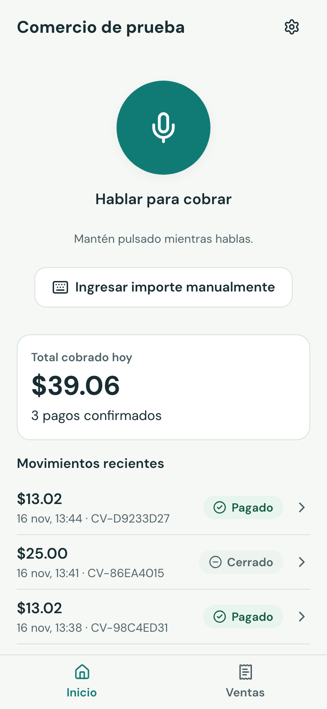
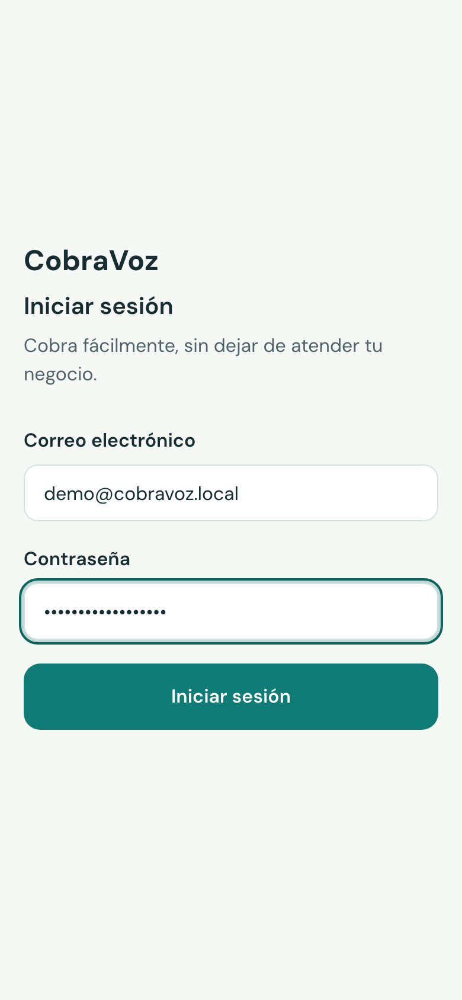
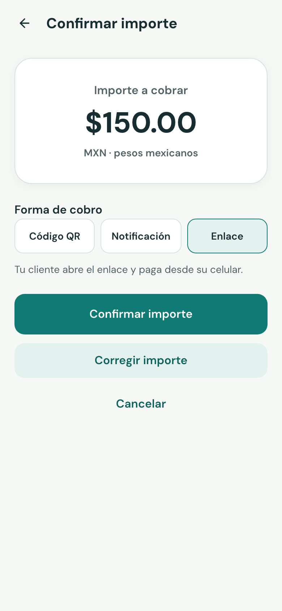
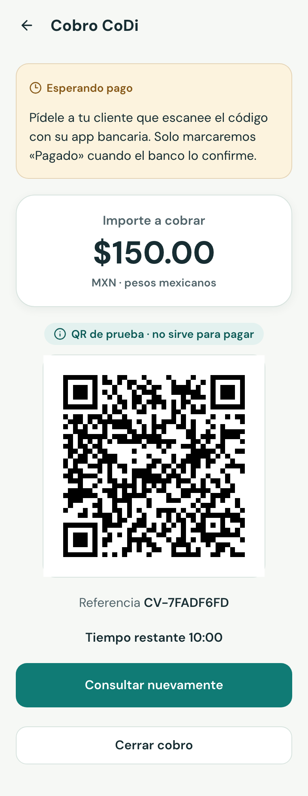
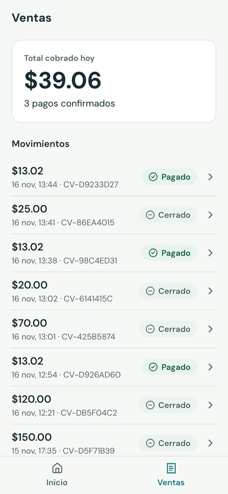
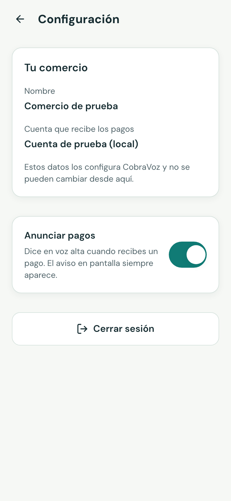

# CobraVoz

**Cobra fácilmente, sin dejar de atender tu negocio.**

PWA para pequeños comercios de México. Dictas o escribes un importe, lo confirmas y muestras un código CoDi. El pago cuenta cuando el banco lo verifica.

<p align="center">
  
</p>

Las capturas son del comercio de demostración en local.

## Qué es

CobraVoz es una aplicación web instalable. El comerciante cobra por CoDi con la voz, o con el teclado, como entrada del importe. Pey genera el código. CobraVoz sigue el cobro, muestra el resultado y guarda las ventas del día.

CobraVoz no procesa tarjetas, no mueve fondos por su cuenta y no sustituye un punto de venta. Es la interfaz de cobro y de seguimiento sobre Pey y CoDi.

## Para quién

Para quien atiende solo un puesto de comida, una fonda o un tianguis: muchos cobros chicos, el teléfono en la mano y poco tiempo para una caja. El mismo ritmo vale para quien vende en un mercado.

## Qué hace

- **Cobrar por voz o a mano.** En Inicio se mantiene pulsado el micrófono, o se escribe el importe.
- **Confirmar antes del código.** La cifra se revisa y se corrige. El QR no se pide hasta pulsar «Confirmar importe».
- **Mostrar el cobro.** Importe, referencia, código y tiempo restante. En local el QR se rotula como prueba.
- **Esperar al banco.** «Consultar nuevamente» lee el estado guardado. «Cerrar cobro» solo cierra la pantalla: no cancela el pago en el banco.
- **Decir el pago recibido.** Si la pantalla de cobro está abierta y «Anunciar pagos» está activo, CobraVoz dice una vez «¡Pago recibido!» y el importe. El aviso en pantalla aparece igual.
- **Ver el día.** El total y el historial suman únicamente pagos conciliados.

## Cómo funciona

1. En Inicio dices el importe, o eliges «Ingresar importe manualmente».
2. CobraVoz muestra la cantidad. Si la voz no se entiende, vuelves a hablar o la escribes. No se asume un monto.
3. Pulsas «Confirmar importe». Esa acción crea la intención de cobro.
4. Si Pey responde, la pantalla de cobro muestra el QR. El importe de esa solicitud ya no cambia.
5. El cliente paga con su app bancaria.
6. Un aviso firmado, o una conciliación que coincide en código, importe, referencia y cuenta, marca el cobro como pagado y la pantalla muestra «¡Pago recibido!». Con la pestaña abierta y «Anunciar pagos» activo, también lo dice una sola vez. Un aviso que no coincide queda como incidencia y no entra en las ventas.
7. Al volver a Inicio o a Ventas, el pago conciliado aparece en el total del día.

<p align="center">
  
</p>

El recorrido de arriba usa la captura manual de $150.00 en el simulador local.

### Así está el piloto

- En local y en preview responde el simulador, aunque exista una clave de Pey. El QR dice «QR de prueba · no sirve para pagar». El importe **$13.01** deja la creación en estado incierto.
- En producción, con `PEY_API_KEY`, el QR bancario es siempre de **$0.01**. El importe confirmado en la app se guarda y se muestra como la venta de ejemplo. El banco mueve un centavo, y ese centavo concilia el cobro.
- Con «Anunciar pagos» activo, un pago que la pantalla de cobro ve llegar se dice una sola vez: «¡Pago recibido!» y el importe en palabras. Hace falta la pestaña abierta. El aviso en pantalla aparece igual si el audio no sale.

## Recorrido

<table>
  <tr>
    <td align="center" width="50%">
      
      <br><strong>Acceso</strong>
      <br>La cuenta llega configurada. No hay registro público.
    </td>
    <td align="center" width="50%">
      
      <br><strong>Confirmación</strong>
      <br>La cifra se ve grande y se confirma a mano.
    </td>
  </tr>
  <tr>
    <td align="center">
      
      <br><strong>Cobro</strong>
      <br>El código, la referencia y el tiempo que queda.
    </td>
    <td align="center">
      
      <br><strong>Ventas</strong>
      <br>Total del día e historial. Solo suma lo conciliado.
    </td>
  </tr>
  <tr>
    <td align="center">
      
      <br><strong>Configuración</strong>
      <br>Comercio, cuenta receptora y preferencia de audio.
    </td>
    <td></td>
  </tr>
</table>

## Cómo ejecutarlo

### Requisitos

- Node.js ≥ 22 (desarrollado con 24) y npm.
- Docker en marcha, para Supabase local.

### Empezar

```bash
npm install
npm run db:start             # Supabase local (Postgres + Auth); la 1.ª vez descarga imágenes
npm run db:env               # genera .env.local con las URLs/claves locales (no se commitea)
npm run db:migrate           # aplica las migraciones de Drizzle
npm run db:seed              # comercio demo + usuario demo@cobravoz.local
npm run dev                  # http://localhost:3000
```

Acceso local: `demo@cobravoz.local` / `cobravoz-local-dev`. Solo abre el Supabase de
esta máquina. El piloto no tiene registro público: el acceso de producción se
comparte aparte y no se escribe en este repositorio.

### Importes

`modules/charges/amount.ts` es la única vía de texto → centavos (enteros, sin `float`;
máx. 2 decimales, > 0). P02 (`/cobro/confirmar`) exige la acción explícita
«Confirmar importe»; `?centavos=` se revalida siempre en el servidor.

### Cobros (PR-05) y pantalla P03 (PR-06)

`POST /api/charges` crea la intención (idempotente por `idempotencyKey`, persistida
**antes** de llamar a Pey) y `GET /api/charges/:id` la consulta. El `merchantId`
sale siempre de la sesión. Repetir la petición devuelve el mismo cobro sin volver
a llamar a Pey; si Pey no confirma el QR, el cobro queda en `qr_uncertain` y no se
reintenta a ciegas. En Local/Preview responde el simulador (`adapters/pey`), aunque
exista `PEY_API_KEY`: el importe **$13.01** fuerza un resultado incierto. En
producción, con `PEY_API_KEY`, el cliente es el real y el QR bancario es de
**$0.01**. Sin clave, fuera de local y preview, `POST /api/charges` responde 503
y no crea la intención.

P03 (`/cobro/[id]`) es una sola pantalla con variantes según el estado **persistido**:
generando QR, esperando pago (QR dibujado localmente desde el `qrString` guardado,
importe, referencia y tiempo restante), verificación no disponible, pagado, expirado,
cerrado localmente, QR incierto e incidencia. Reglas:

- El estado sale siempre de `GET /api/charges/:id` (consulta periódica cada 5 s,
  pausada con la pestaña oculta, más «Consultar nuevamente»). Ningún botón ni el
  reloj del teléfono marcan un cobro como pagado, vencido o cerrado.
- El vencimiento lo aplica el **servidor al leer** (`waiting_payment` con
  `expires_at` pasado → `expired`); el tiempo restante se calcula con la hora del
  servidor (`serverTime`). Vencer no borra el QR ni impide conciliar un pago tardío.
- `POST /api/charges/:id/close` («Cerrar cobro») es un cierre **local**: solo desde
  `waiting_payment`, idempotente, con aviso de que no cancela el pago bancario. Si el
  cobro ya cambió (pagado, vencido) responde 409 con el estado real.
- Un QR del simulador se rotula siempre «QR de prueba».
- Al pasar de `waiting_payment` a `paid` con la pestaña visible, y con «Anunciar pagos» activo, la pantalla dice el importe una sola vez (`adapters/speech`). Si el audio no sale, la confirmación sigue en pantalla. Reabrir el cobro no repite el anuncio.

### Pagos por webhook (PR-07)

`POST /api/webhooks/pey` es público: no usa sesión ni Origin. Exige firma
Standard Webhooks (`webhook-id`, `webhook-timestamp`, `webhook-signature`) con
`PEY_WEBHOOK_SECRET`. Una firma inválida responde 401 y no se guarda. Si la firma
vale y el aviso coincide en QR, importe, referencia numérica y cuenta, el cobro
pasa a `paid` en la misma transacción, también si ya estaba vencido o cerrado en
local. Un importe, cuenta o referencia distintos deja el pago como incidencia y
no lo cuenta como venta. El mismo `webhook-id` o el mismo `transactionId` no
crean otro pago. Si el aviso no llega, la conciliación (PR-08) consulta a Pey y
acredita el cobro solo cuando la evidencia coincide.

### Autenticación y autorización

- **Supabase Auth SSR** (cookies). `proxy.ts` renueva la sesión y redirige a `/acceso`
  si falta (chequeo optimista); la autorización real se repite junto a los datos con
  `auth.getUser()` + vínculo `merchant_users` (`modules/identity`).
- El `merchant_id` **siempre sale de la sesión**, nunca del cliente.
- Rutas privadas: `/inicio`, `/configuracion`, `/cobro/*` (y `/api/*` con 401/403 propios).
- Los Route Handlers que mutan usan `withMerchantApi` (comprueba `Origin` y responde
  `Cache-Control: private, no-store`). Los Server Actions ya validan `Origin`.
- `npm run check:bundle` (tras `build`) falla si un secreto de servidor llega al cliente.

Detalles del modelo de datos, estados y seguridad: [`adapters/db/README.md`](adapters/db/README.md).

## Scripts

| Script                            | Qué hace                                                   |
| --------------------------------- | ---------------------------------------------------------- |
| `npm run dev` / `build` / `start` | Next.js                                                    |
| `npm run lint`                    | ESLint                                                     |
| `npm run typecheck`               | Genera tipos de rutas y ejecuta `tsc --noEmit`             |
| `npm run test`                    | Pruebas unitarias y de componentes (Vitest)                |
| `npm run e2e`                     | E2E con Playwright contra el build (`npm run build` antes) |
| `npm run format` / `format:check` | Prettier                                                   |
| `npm run db:*`                    | Supabase local, migraciones y seed (ver `adapters/db`)     |
| `npm run test:db`                 | Pruebas de integración contra Postgres local               |
| `npm run check:bundle`            | Falla si hay secretos de servidor en el bundle del cliente |
| `npm run icons`                   | Regenera los iconos temporales de la PWA                   |
| `npm run check`                   | `lint` + `typecheck` + `test`                              |

La primera vez que se corran los E2E: `npx playwright install chromium`
(y `webkit` con `E2E_WEBKIT=1` para Safari iOS).

## Estructura

```
app/          Rutas (App Router): landing `/`, acceso `/acceso`, app `/inicio` y `/configuracion`, `/api`
components/   UI genérica (shadcn/ui + componentes de DESIGN.md) y PWA
lib/          Utilidades y configuración pública
modules/      Dominios del monolito modular (identity, merchant, voice, charges, ...)
adapters/     Infraestructura externa (db, pey, stt), solo servidor
proxy.ts      Renovación de sesión y redirección a /acceso
e2e/          Pruebas Playwright (las de sesión requieren Supabase local)
```

## Reglas que no se negocian

- Dinero en centavos enteros; nunca `float` en el dominio.
- Un pago solo es «Pagado» con evidencia bancaria verificada en backend.
- Nunca se crea un QR ni se confirma un pago a partir de la transcripción de voz.
- Claves de Pey, OpenAI y base de datos solo en servidor (jamás `NEXT_PUBLIC_*`).
- El adaptador Pey simulado solo existe en Local/Preview.

## Documentación

La fuente de verdad del producto está en [`docs/`](docs):

- [PRD v1.0](docs/CobraVoz_PRD_v1.0.md)
- [Especificación de UX](docs/CobraVoz_UX_Specification_v1.0.md)
- [Arquitectura](docs/CobraVoz_Architecture_Specification_v1.0.md)
- [DESIGN.md](docs/DESIGN.md)
- [Plan de implementación](docs/IMPLEMENTATION_PLAN.md)
