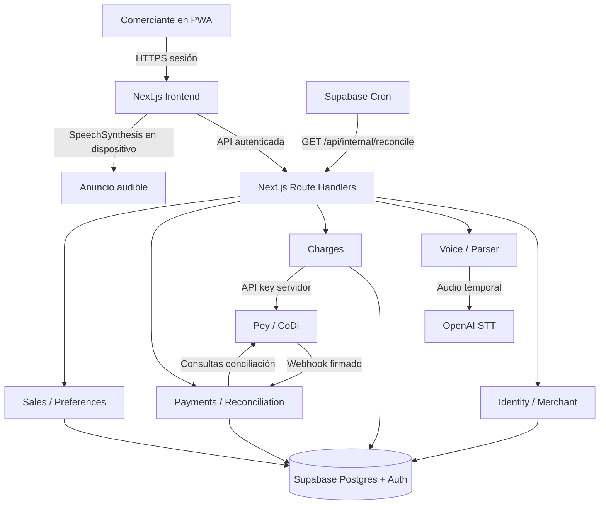
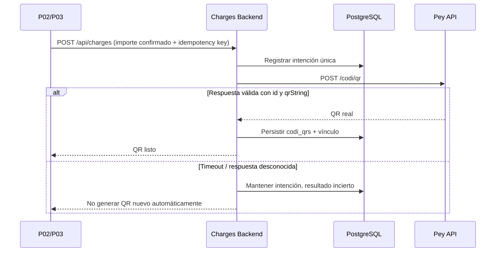

# CobraVoz — Architecture Specification

**Versión:** 1.0  
**Estado:** APROBADO Y CONGELADO  
**Fecha de consolidación:** 15 de noviembre de 2026  
**Arquitectura:** monolito modular, PWA mobile-first, servicios administrados  
**Fuentes de verdad:** `CobraVoz_PRD_v1.0.md` + `CobraVoz_UX_Specification_v1.0.md`.

> Este archivo consolida los seis bloques técnicos aprobados (3.1–3.6). Los nombres de rutas y estructuras son contratos de implementación propuestos dentro de la arquitectura aprobada. Los detalles de respuesta exactos de Pey deben cotejarse con su documentación vigente antes de programar la integración productiva.

> **Cambio 2026-11-18.** El cobro puede ser un QR, que sigue como default, o una notificación CoDi. El contrato de Pey está en `adapters/pey/README.md`. La sección 17 registra el modelo. No reabre el anuncio al comerciante con la PWA cerrada.

> **Cambio 2026-11-18, enlace.** La tercera forma es el enlace de pago. La sección 18 registra el modelo. El cron de Supabase no cambia. En el MVP el enlace también mueve $0.01.

## 1. ADR y decisiones congeladas

| ADR | Decisión | Razón |
|---|---|---|
| ADR-01 | Next.js 16 + React + TypeScript como PWA | Un proyecto para frontend y backend |
| ADR-02 | Monolito modular; Next.js Route Handlers | MVP simple sin microservicios |
| ADR-03 | Tailwind CSS 4 + shadcn/ui | UI consistente y accesible |
| ADR-04 | PostgreSQL administrado en Supabase + Drizzle ORM | Integridad relacional y migraciones tipadas |
| ADR-05 | Supabase Auth SSR | Correo y contraseña. `/registro` crea el comercio sin verificación de correo |
| ADR-06 | `getUserMedia` + `MediaRecorder`, grabación breve | Captura web multiplataforma |
| ADR-07 | OpenAI `gpt-transcribe` inicial, sustituible si fallan pruebas | STT desacoplado |
| ADR-08 | Parser determinista en TS | Importe verificable, sin inferencia probabilística monetaria |
| ADR-09 | Web Speech Synthesis API para anuncios `es-MX` | No introducir un TTS remoto para MVP |
| ADR-10 | Pey / CoDi. El backend genera el QR o envía la notificación; webhooks firmados | Cobro bancario verificable |
| ADR-11 | Vercel + Supabase para producción | Infraestructura administrada |
| ADR-12 | Polling controlado del estado; no WebSockets | Complejidad mínima |
| ADR-13 | Supabase Cron (`pg_cron` + `pg_net`) llama cada 5 minutos a `GET /api/internal/reconcile` | Vercel Hobby solo permite un cron al día; el secreto vive en Vault |
| ADR-14 | Dinero en centavos enteros; persistencia atómica e idempotente | Seguridad financiera |

**Límites:** varios comercios pueden registrarse; todos copian la misma cuenta receptora Pey desde `PEY_BANK_ACCOUNT_ID`. No POS completo, inventario, múltiples pasarelas, verificación de correo, escucha permanente ni colas/microservicios en MVP.

## 2. Contexto y componentes

**Fuente de verdad:** PostgreSQL contiene estado y evidencia persistidos; el cliente obtiene proyecciones de lectura. Ni STT ni UI confirman pagos. El pago puede recibirse aunque la PWA esté cerrada.

## 3. Módulos internos y dependencias

| Módulo | Responsabilidad | Puede depender de | No puede hacer |
|---|---|---|---|
| Identity | Validar sesión/autorización y alcance por merchant | Supabase Auth | Dar acceso global por tener sesión |
| Merchant | Nombre y datos mínimos de cuenta receptora | Identity, DB | Cambiar cuenta desde UI MVP |
| Voice | Validación audio, transcripción y parser | Identity, OpenAI | Crear QR o confirmar pagos |
| Charges | Persistir intención, aplicar idempotencia, generar QR Pey | Identity, DB, Pey adapter | Declarar pago exitoso sin Payments |
| Payments | Validar firma/webhook, conciliar, transaccionar pagos | DB, Pey adapter | Confiar en declaraciones del navegador |
| Sales | Historial y agregados de pagos conciliados | Identity, DB | Alterar movimientos bancarios |
| Preferences | Audio habilitado por comerciante | Identity, DB | Editar cobros/pagos |

**Estructura conceptual (no código generado):** Presentation/UI → Route Handlers → servicios de dominio → adaptadores de infraestructura (DB, Pey, STT). Definir esquemas de validación y tipos entre capas. No colocar lógica bancaria en componentes React.

## 4. Modelo de datos v1.0

### Entidades aprobadas

1. `merchants`: UUID; nombre, zona horaria del negocio (IANA, por defecto configurada `America/Mexico_City` solo para demo si corresponde), identificador de cuenta Pey receptora y campos públicos no sensibles.
2. `merchant_users`: vincula `auth.users.id` de Supabase con `merchant_id`; limitar acceso a merchant autorizado.
3. `merchant_preferences`: `merchant_id` único; `voice_announcements_enabled` true por defecto y fechas de actualización.
4. `charges`: UUID, merchant_id, `amount_cents`, `currency=MXN`, estado, clave de idempotencia, fechas (`created_at`, `expires_at`, `closed_at` según corresponda).
5. `codi_qrs`: UUID, `charge_id` único, `pey_qr_id` único cuando exista, `num_ref`, `qr_payload`, expiración y timestamps.
6. `payments`: UUID, `codi_qr_id`, `provider_transaction_id` único, `amount_cents`, verificación/conciliación, `paid_at` (fecha efectiva) y `recorded_at`.
7. `payment_events`: identificador de entrega del proveedor, tipo, validación, resultado de procesamiento, timestamps y asociaciones a QR/pago cuando existan.
8. `payment_incidents`: referencia a cobro y pago cuando existan, tipo, motivo, estado de seguimiento, timestamps.

### Relaciones cardinales

- Merchant 1:N charges.
- Merchant 1:N merchant_users (aunque pilotaje tenga uno); merchant 1:1 merchant_preferences.
- Charge 1:0..1 QR generado **válido/persistido**; si la solicitud externa queda incierta, charge existe sin QR confirmado.
- QR 1:N payments para registrar cualquier movimiento externo excepcional (no asumir que siempre hay máximo uno).
- Payments 1:N events como asociación lógica; un evento recibido puede carecer inicialmente de pago resuelto, por lo que la FK correspondiente podrá ser nula.
- Charge y/o payment 1:N incidents.

### Restricciones de BD obligatorias

- PK UUID; FK explícitas; índices en merchant_id, estados y fechas.
- `amount_cents > 0`, enteros; `currency='MXN'`.
- `(merchant_id, idempotency_key)` único por intención.
- `pey_qr_id` único cuando exista; `provider_transaction_id` único por proveedor; `(provider, webhook_id)` único.
- `charge_id` único en `codi_qrs` según cardinalidad congelada.
- Restricciones contra registro contradictorio de cobro confirmado sin evidencia verificada.
- Procesar creación/registro de pago y actualización del cobro en transacción atómica.
- Mantener `paid_at` separado de `recorded_at`; zona horaria del merchant en la **consulta de reportes**, no modificando timestamp UTC de la fuente.

### Estados y semántica

Estados de dominio: `created`, `waiting_payment`, `paid`, `expired`, `locally_closed`, `incident`. «Generando QR» es transitorio; «verificación no disponible» describe conectividad/verificación y no es pago rechazado. Puede usarse un estado **técnico interno** para creación externa incierta, sin inventar un QR; documentar la transición concreta al implementar.

**Importante:** vencimiento o cierre local no prohíben registrar un pago tardío. Si hay discrepancia, registrar pago/incidente sin sumarlo automáticamente como venta conciliada.

## 5. Contratos internos HTTP (propuestos)

| Método | Ruta | Autenticación | Función |
|---|---|---|---|
| POST | `/api/voice/transcribe` | Sesión merchant | Validar/grabar temporalmente, transcribir y parsear |
| POST | `/api/charges` | Sesión merchant | Crear intención idempotente, solicitar QR si seguro |
| GET | `/api/charges/:id` | Sesión + propiedad | Estado actual con QR si existe |
| POST | `/api/charges/:id/close` | Sesión + propiedad | Cierre **local** |
| POST | `/api/charges/:id/reconcile` | Sesión + propiedad | Consulta manual a Pey |
| POST | `/api/webhooks/pey` | **Firma Pey** (no cookie de usuario) | Registrar evento validado y conciliar |
| GET | `/api/sales` | Sesión + propiedad | Historial paginado, estados completos |
| GET | `/api/sales/summary` | Sesión + propiedad | Total y conteo del día |
| GET | `/api/preferences` | Sesión + propiedad | Preferencias |
| PATCH | `/api/preferences` | Sesión + propiedad | Actualizar audio |
| GET | `/api/internal/reconcile` o equivalente | Secreto interno cron | Conciliar pendientes |

La semántica concreta de rutas/cuerpo/DTO puede afinarse dentro de estos contratos sin cambiar UX ni reglas financieras. Jamás confiar en `merchant_id` que envíe el cliente: derivarlo de la sesión autorizada.

### Contrato monetario

- Dominio: `amount_cents` como entero positivo, evitando decimales binarios.
- Cliente: se puede mostrar pesos con dos decimales, pero el servidor revalida importes.
- Adaptador Pey: convertir cuidadosamente a la representación `amount` documentada por Pey y confirmar que respuesta coincide.
- No usar float para aritmética financiera; conversiones precisas por cadenas o decimal.

## 6. Proceso A — Audio → importe

1. En P01, el comerciante activa captura explícita (getUserMedia + MediaRecorder); duración inicial máxima 15 s.
2. Comprobar formato soportado y tamaños; detener manualmente y enviar HTTPS a endpoint autenticado.
3. Backend aplica tamaño/duración/frecuencia máximos y envía audio temporal a `gpt-transcribe`.
4. Recibe texto, sin almacenar permanentemente grabación ni transcripción en DB; consultar políticas de retención del proveedor.
5. Parser determinista interpreta expresiones en `es-MX`, pesos/centavos, con pruebas unitarias extensas.
6. Si no existe exactamente un importe inequívoco válido (>0, ≤2 decimales), retornar error de interpretación, no cobrar.
7. P02 exige confirmación manual; UI permite corrección o volver a hablar.

**Alternativa:** entrada manual disponible sin micrófono. **No** usar STT para autorizar cobros directamente.

## 7. Proceso B — Crear intención y QR Pey

### Parámetros del contrato aprobado con Pey

- Endpoint principal: `POST /codi/qr` a `https://api.pey.mx` con API key Bearer del servidor.
- `amount`: valor autorizado en pesos, convertido desde centavos enteros.
- `concept`: texto breve del cobro; `expiration`: **600 segundos iniciales**.
- `numRef`: referencia numérica **máximo 7 dígitos**, gestionando colisiones y reutilización; distinta de referencia humana `CV-...`.
- `generateImage`: `false`; construir QR visual desde `qrString` real, nunca sintetizar un QR falso.
- `metadata`: UUID interno de charge para correlación; `bankAccountId` si es necesario para seleccionar la cuenta ya registrada.
- Persistir `pey_qr_id` y `qr_payload` devueltos por Pey antes de exponerlos como listos.

Contrato cotejado el 2026-11-16 con el OpenAPI de Pey del 2026-10-20. En el QR real, `amount` es siempre `0.01`: el importe capturado se queda en el cobro. `numRef` se envía como texto de dígitos. El webhook documentado trae `amount` numérico, `numRef` texto, `datePaid` en segundos Unix y `bankAccountId` cuando se envió al crear. `GET /transaction/codi/qr/:id` no repite referencia ni cuenta; un pago de esa lista se concilia con las del QR guardado. Un aviso de exactamente 1 centavo cierra el cobro.

**Incertidumbre no resuelta:** Pey no tiene documentado en la especificación aprobada un parámetro de idempotencia para creación ni recuperación segura de QR cuyo identificador no fue recibido. Si hay timeout, **no repetir ciegamente**. Validar antes de automatizar y tratar el incidente como pendiente de investigación.

## 8. Proceso C — Webhook → pago

1. Endpoint público recibe solicitud HTTPS con cuerpo **raw** y encabezados originales.
2. Verificar firma Standard Webhooks y ventana anti-replay acorde a especificación oficial; rechazar inválidos.
3. Corroborar tipo `codi.qr.payment_received`, `transactionId`, `codiQrId`, importe, referencia y cuenta/API key cuando corresponda.
4. Validar duplicados con `webhook-id` y `transactionId`; el identificador del webhook no sustituye unicidad de pago.
5. Dentro de una transacción DB registrar evento, pago y estado final del cobro si todo coincide.
6. En caso de discrepancia, conservar evidencia y crear incidencia sin sumar total conciliado.
7. Responder éxito **después** de persistencia. Si falla persistencia, permitir recuperación/reintento seguro.
8. Frontend actualiza estado mediante consulta a backend; solo anuncia evento fresco verificado con PWA activa y audio permitido.

**Seguridad:** un webhook no depende de sesión merchant; se autentica criptográficamente. Un evento repetido no multiplica pagos ni alertas.

## 9. Proceso D — Sincronización y conciliación

- P03 pendiente consulta `/api/charges/:id` periódicamente mientras app activa; frecuencia ajustable tras mediciones, sin WebSockets.
- «Consultar nuevamente» invoca `/api/charges/:id/reconcile`, usando consulta a Pey e idéntica lógica de procesamiento.
- Supabase Cron (`pg_cron` + `pg_net`), protegido por `CRON_SECRET`, inspecciona pendientes, expirados recientes, cierres locales relevantes e incidencias recuperables; **intervalo inicial 5 min**. El horario no está en Vercel: el plan Hobby rechaza una expresión que corre más de una vez al día.
- Consultas oficiales aprobadas: `GET /transaction/codi/qr/:id` y `GET /transaction/:id`; paginar cuando aplique (`nextToken`).
- Reconciliar solo si el QR/ID externo conocido está disponible; no inferir QR que nunca devolvió identificador.
- Tras reapertura, P01 recupera del backend estados y pendientes; **sin** anuncio de pagos ocurridos mientras app estaba cerrada.
- Respetar límites de proveedor y registrar cuándo se ejecutó el último intento de conciliación.

## 10. Totales diarios y fechas

- Movimientos `paid` verificados y conciliados correctamente son los **únicos** que suman total y conteo.
- `paid_at` = instante real del pago; `recorded_at` = instante de persistencia en CobraVoz.
- Convertir `paid_at` a zona horaria IANA del negocio para determinar el día comercial; mantener timestamps UTC en almacenamiento.
- Historial muestra también pendientes, expirados, cerrados localmente e incidencias, sin contarlos.
- Pagos tardíos se asignan al día real de pago, **no** al día del webhook.
- Reportes derivados de tablas fuente; sin tabla de ventas duplicada para MVP.

## 11. Autenticación, autorización y defensa en profundidad

- Supabase Auth correo/contraseña. `/registro` crea el usuario ya confirmado y su comercio; no envía correo de verificación.
- SSR con sesión basada en cookies seguras; validar identidad y relación merchant–usuario en servidor, incluidas rutas de lectura.
- Drizzle accede a Postgres desde backend: implementar scoping explícito por `merchant_id`, no asumir RLS automático sobre conexión privilegiada.
- `DATABASE_URL`, `PEY_API_KEY`, `PEY_BANK_ACCOUNT_ID`, `PEY_WEBHOOK_SECRET`, `OPENAI_API_KEY`, `CRON_SECRET` únicamente server-side.
- Clave publicable de Supabase puede estar en cliente; **nunca** exponer service-role/secret keys o API keys de Pey/OpenAI.
- Validación de DTO, límite de solicitudes (sobre todo voz, login y cobros), CSRF/Origin en mutaciones con cookie, CORS restringido, TLS y cabeceras de no-caché en datos privados.
- Webhook: firma validada antes de interpretar payload; límites razonables sin bloquear indebidamente entrega genuina.
- Logs sin grabaciones, tokens o datos de cuenta innecesarios.
- Preferencias de audio y opción de logout persistentes.

## 12. Infraestructura y operaciones

| Entorno | Infraestructura | Uso de Pey |
|---|---|---|
| Local | Next.js local + BD de desarrollo aislada | Mock/fake adapter; sin pagos reales |
| Preview | Vercel Preview + servicios separados | Mock de eventos/QR; por defecto sin transacciones bancarias |
| Production | Vercel + Supabase Pro (propuesta aprobada) | Pey real con credenciales protegidas |

- El cron de 5 min corre en Supabase (`pg_cron`), no en Vercel. Hobby corta la función cerca de los 10 s; una pasada más larga se retoma en el siguiente ciclo.
- Supabase Pro propuesto para respaldos automáticos; verificar restauración y conciliar pagos posteriores a backup.
- Usar transaction pooler en runtime serverless; configurar cliente Drizzle/driver para limitaciones de prepared statements del pooler.
- Migraciones versionadas, permisos mínimos y conexión apropiada de migración; separar entornos y secretos.
- Logs/eventos críticos: firma inválida, error de generación QR, timeout incierto, fallo DB, incidencia por monto, webhook duplicado, reconciliación pendiente.
- Alertas de fallas reiteradas; política de rotación de secretos y restauración comprobada.

## 13. Reglas de resiliencia

| Falla | Conducta obligatoria |
|---|---|
| Pérdida de conexión antes de generar QR | No generar QR offline, conservar importe/contexto |
| Timeout al crear QR | Estado incierto, **sin reintento automático** |
| Doble clic al confirmar | La misma intención retorna mismo registro interno, no duplica por el frontend |
| Webhook repetido | Idempotencia por evento y transacción |
| Webhook inválido | Rechazar; no marcar pagado |
| Webhook sin poder persistirse | No reconocer procesamiento como exitoso; permitir retry/conciliación |
| QR expirado / cobro cerrado localmente | Mantener posibilidad de recibir y reconciliar pago tardío |
| PWA cerrada | Backend continúa persistiendo y reconciliando |
| STT falla | Captura manual sin hacer cobro supuesto |
| SpeechSynthesis no funciona | Éxito visual mantiene validez |
| DB restaurada desde respaldo | Realizar reconciliación adicional con Pey según registros disponibles |

## 14. Validaciones técnicas pendientes (no cambian alcance)

- Confirmar idempotencia real de creación en Pey y cómo resolver timeout sin QR ID.
- Confirmar formatos/latencia/precisión STT en Android e iOS bajo ruido.
- Comprobar políticas de tratamiento y retención del audio del proveedor.
- Verificar límites exactos de Pey y cron/plans contratados.
- Medir el polling, costo de conciliación y la persistencia de eventos tardíos.
- Probar restauración de respaldo y recuperación operativa.
- Ejecutar cobro CoDi real por importe pequeño con webhooks de producción **solo** en fase segura de integración.

## 15. Criterios de aceptación arquitectónica

1. Nunca hay secretos bancarios en navegador o bundle público.
2. Nunca se crea QR sin importe válido y confirmación explícita.
3. Cada intención es identificable e idempotente en CobraVoz.
4. Un mismo pago bancario no puede registrarse dos veces.
5. El servidor funciona sin PWA abierta.
6. Fallas de webhooks son recuperables mediante conciliación cuando hay referencia externa.
7. La interfaz no afirma pagos no verificados.
8. Reabrir aplicación no altera pagos ni duplica anuncios.
9. Totales diarios provienen de pagos verificados en fecha efectiva de merchant.
10. La implementación mantiene cinco módulos MVP y siete pantallas; sin expansión de alcance.

## 16. Control de cambios

**Architecture Specification v1.0 APROBADA Y CONGELADA.** Modificar stack, cardinalidades de datos, reglas de pagos, seguridad o procesos de reconciliación exige aprobación explícita y versión nueva. `DESIGN.md` solo gobierna la representación visual; `IMPLEMENTATION_PLAN.md` solo ordena la ejecución técnica.

El cambio del 2026-11-18 agrega la notificación como segundo instrumento. El cron, el webhook y la regla del centavo no cambian.

## 17. Cobro por notificación

- `charges.collection_method` es `qr`, `pn` o `link`. En `pn`, el cobro guarda el SHA-256 del celular de 10 dígitos y los últimos 4. El número completo no se persiste ni sale en el DTO.
- `codi_notifications` existe solo cuando `POST /codi/pn` respondió 200 con `transactionId` y `codiId`. `charge_id` es único. Si la creación queda incierta, no hay fila y no se reintenta.
- `payments` apunta a exactamente uno de `codi_qr_id`, `codi_notification_id` o `payment_link_id`.
- El webhook sigue siendo uno por clave. `codi.pn.payment_received` se casa por `transactionId`. Un id desconocido no crea un cobro.
- La conciliación del aviso usa `GET /transaction/:transactionId`. El mismo cron de Supabase llama al mismo `GET /api/internal/reconcile`.
- El total del día incluye los tres instrumentos y suma `payments.amount_cents`, el dinero recibido.

## 18. Cobro por enlace

- `POST /payment-link/create` envía $0.01. El cobro guarda el importe capturado. No se llama a `POST /payment-link/update`.
- `payment_links` existe solo tras un 200 con `id` y `url` HTTPS. `charge_id` y `pey_payment_link_id` son únicos.
- Un 400 deja `qr_uncertain` con `creation_result = rejected` y una incidencia `other` cuyo motivo es solo `error.type`. Un 500, un timeout o un 200 incompleto dejan `creation_result = uncertain`. Ninguno se reintenta.
- `successUrl` y `backUrl` son páginas públicas. No viven bajo `/cobro` y no marcan el pago.
- El webhook `payment_link.status_updated` se casa por `paymentLinkId`. Un id desconocido no crea un cobro. `pending`, `processing` y `partial` no cierran. `paid` cierra si la base es $0.01 o coincide con el importe del cobro. `payments.amount_cents` guarda el monto liquidado.
- La conciliación usa `GET /payment-link/:id` en el mismo cron. Una consulta no disponible no marca pagado y no borra el cobro.
